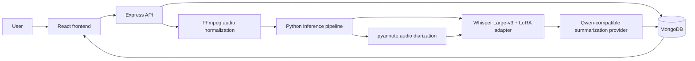

# Meetly

**An AI-assisted meeting transcription and summarization system for Algerian
Darija.**

Meetly brings together automatic speech recognition, speaker diarization, and
large-language-model summarization in a full-stack application. It was
developed as a team project at ESI-SBA and is documented in the accompanying
[project report](docs/reports/rapport_meetly.pdf) (French).

## Project at a glance

- Fine-tune **OpenAI Whisper Large-v3** for Algerian Darija/Arabic speech using
  **LoRA** parameter-efficient adaptation.
- Convert meeting recordings to a consistent 16 kHz, mono WAV format with
  FFmpeg.
- Transcribe speech in Arabic and, when configured, associate segments with
  speakers using **pyannote.audio**.
- Produce French executive summaries, key points, decisions, and action items
  using a Qwen-compatible language-model provider.
- Review recordings, transcripts, and summaries in a React application backed
  by an Express API and MongoDB.

## System architecture



The Python pipeline uses the `openai/whisper-large-v3` base model, matching the
base model recorded in the trained adapter configuration. Speaker diarization
is enabled when a Hugging Face token and access to the diarization model are
configured; otherwise, the pipeline transcribes the recording as a single
speaker.

## Model and training approach

The training notebook,
[whisper_darja_lora.ipynb](ml/training/whisper_darja_lora.ipynb), documents the
Whisper fine-tuning workflow. The project explores successive ASR
configurations; the final configuration described in the report uses:

- **Base model:** Whisper Large-v3.
- **Adaptation:** LoRA with rank 32 and alpha 64.
- **Target modules:** attention projections (`q_proj`, `k_proj`, `v_proj`,
  `out_proj`) and feed-forward layers (`fc1`, `fc2`).
- **Regularization and audio robustness:** LoRA dropout, SpecAugment, and audio
  augmentation.
- **Training setup:** AdamW, a cosine learning-rate schedule, warmup, and
  gradient checkpointing.
- **Evaluation:** held-out evaluation with Word Error Rate (WER); the report
  also discusses Character Error Rate (CER) for dialectal text.

The local training output contains checkpoints at steps 700, 800, and 900. The
best recorded checkpoint is step 900. The application loads its LoRA adapter
alongside the original Whisper base model; optimizer and scheduler files are
training-resume artifacts, not inference weights.

The application adapter is published at
[soumia11111/whisper-darja-lora-v2](https://huggingface.co/soumia11111/whisper-darja-lora-v2).
At inference startup, the backend uses the local directory configured by
`CUSTOM_MODEL_PATH` (default: `./models/whisper-darja-lora-v2`). If
`adapter_model.safetensors` is not present there, it downloads the adapter
from this Hugging Face repository. If the adapter cannot be downloaded or
loaded, transcription continues with the Whisper Large-v3 base model.

### Reported results

| Evaluation record | Step | Eval loss | WER |
|---|---:|---:|---:|
| Best metric recorded in the step-900 training state | 900 | 1.3815 | 105.61% |

The project report also presents a comparative progression across three ASR
versions: a baseline, a regularized version, and the final LoRA-based
Whisper Large-v3 approach. It discusses the sensitivity of WER to word
segmentation and normalization in Darija and the complementary use of CER.
Metrics above are reproduced from the available checkpoint metadata; refer to
the report and notebook for experimental context and evaluation methodology.

## Repository guide

| Path | Description |
|---|---|
| `frontend/` | React/Vite application: authentication, dashboard, recording, history, transcript, and summary views |
| `backend/` | Express API, authentication, MongoDB models, audio uploads, and pipeline orchestration |
| `backend/services/pipeline.py` | Python inference: optional speaker diarization and Whisper + LoRA transcription |
| `backend/services/pipelineService.js` | Audio normalization, inference orchestration, and summary workflow |
| `backend/services/summarizationService.js` | OpenRouter, DashScope, and Ollama-compatible summary integrations |
| `ml/training/whisper_darja_lora.ipynb` | Whisper training, evaluation, and experimentation |
| `ml/training/augment_audio.py` | Offline audio augmentation utility |
| `docs/reports/rapport_meetly.pdf` | Full project report (French) |
| `docs/presentation/` | Separate browser presentation |

## Run the application locally

### Prerequisites

- Node.js and npm.
- Python 3.10 or newer.
- FFmpeg installed and available on `PATH`.
- MongoDB running locally or an accessible MongoDB connection.
- Internet access on the first run so the Whisper base model and published
  adapter can be downloaded and cached locally.
- A CUDA-capable GPU is recommended for Whisper Large-v3. CPU inference is
  supported but slower.
- Optional: a Hugging Face token with access to the selected pyannote model for
  speaker diarization, and an API key for OpenRouter or DashScope. Alternatively,
  configure a local Ollama server for summarization.

### 1. Configure and start the backend

From the repository root, create the backend environment file:

```powershell
Copy-Item backend\.env.example backend\.env
```

Edit `backend\.env` and provide values for:

```dotenv
PORT=5000
MONGO_URI=mongodb://localhost:27017/meetly
JWT_SECRET=replace-with-a-long-random-secret
CLIENT_ORIGINS=http://localhost:5173
CUSTOM_MODEL_PATH=../models/whisper-darja-lora-v2
PYTHON_PATH=C:\path\to\project_meetly\backend\.venv\Scripts\python.exe
DEVICE=cuda
FFMPEG_PATH=ffmpeg
HF_TOKEN=your_huggingface_token
QWEN_PROVIDER=openrouter
OPENROUTER_API_KEY=your_provider_api_key
QWEN_MODEL=qwen/qwen-2.5-72b-instruct
```

Set `CUSTOM_MODEL_PATH=../models/whisper-darja-lora-v2` when running the backend
from its `backend/` directory, or leave the variable unset to use the
repository-root `models/whisper-darja-lora-v2` default. This directory caches
the adapter downloaded from
`soumia11111/whisper-darja-lora-v2`; a local step-900 checkpoint can also be
used by setting the variable to that checkpoint's directory.

Use `DEVICE=cpu` if CUDA is unavailable. `HF_TOKEN` is optional for a public
adapter, but may be needed for gated Hugging Face models such as PyAnnote. For
Ollama, set
`QWEN_PROVIDER=ollama`, configure `QWEN_MODEL` to a locally installed model,
and set `OLLAMA_API_BASE` if the server is not at its default URL. For
DashScope, use `QWEN_PROVIDER=dashscope` and configure `QWEN_API_KEY`.

Install backend dependencies and create its Python environment:

```powershell
cd backend
npm ci
python -m venv .venv
.\.venv\Scripts\python.exe -m pip install -r requirements.txt
```

Install a PyTorch build compatible with your CUDA drivers if GPU inference is
required. Install and start MongoDB, ensure FFmpeg is on `PATH`, then start the
API:

```powershell
npm run dev
```

### 2. Configure and start the frontend

In another terminal from the repository root:

```powershell
Copy-Item frontend\.env.example frontend\.env.local
cd frontend
npm ci
npm run dev
```

The default frontend API URL is `http://localhost:5000/api`. To use a
different backend address, set `VITE_API_URL` in `frontend\.env.local`, for
example:

```dotenv
VITE_API_URL=http://localhost:5000/api
```

Open the local URL printed by Vite, create an account, and upload a short audio
recording to exercise the transcription and summary workflow.

### Training notebook and dataset

The training audio and dataset are not bundled with the source. Set
`MEETLY_DATASET_DIR` to the local dataset directory before running
`ml/training/augment_audio.py` or the notebook. Install the notebook's
training dependencies and select a compatible GPU runtime before starting a
training run. The notebook includes the data preparation, augmentation, LoRA
configuration, training, and evaluation stages.

## Team

This project was developed collaboratively. The report credits:

- Kambouz Nouha
- Amari Soumia
- Mohammed Ousaid Ahlem
- Merzouk Imane Nabahat
- Berrahou Meriem
